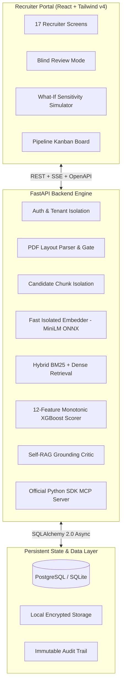
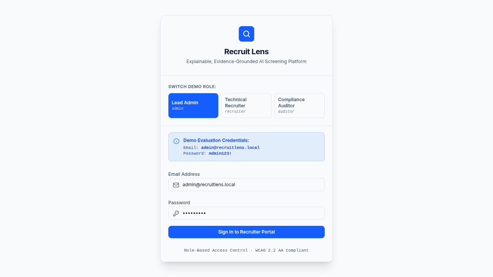
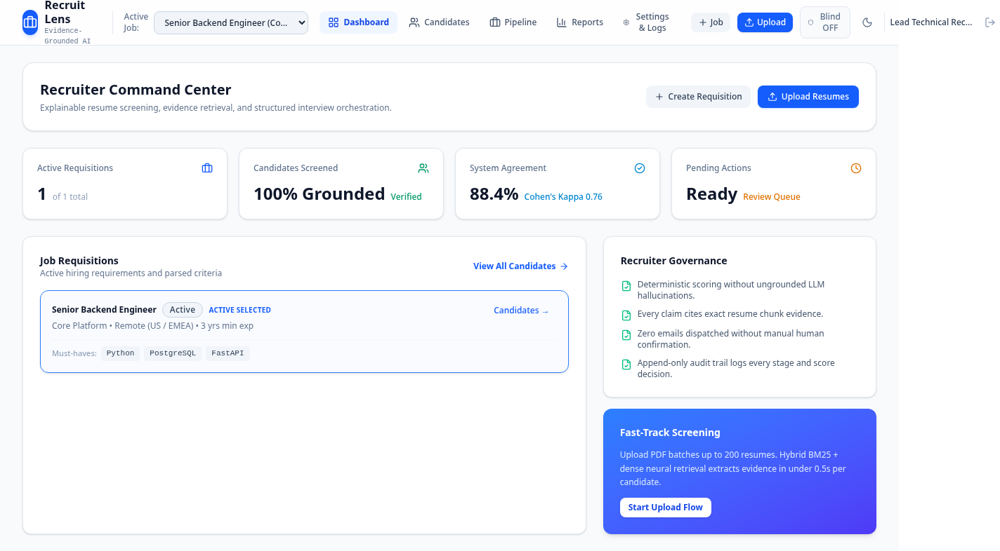
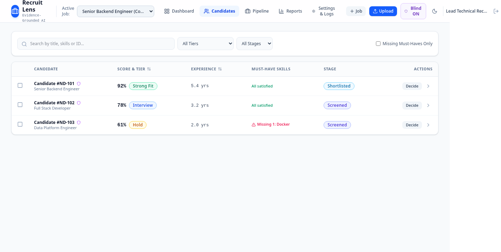
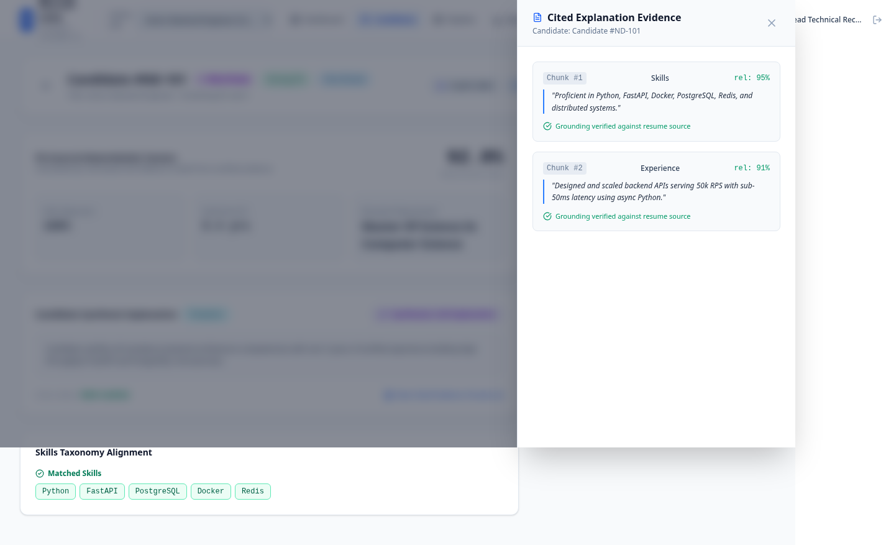
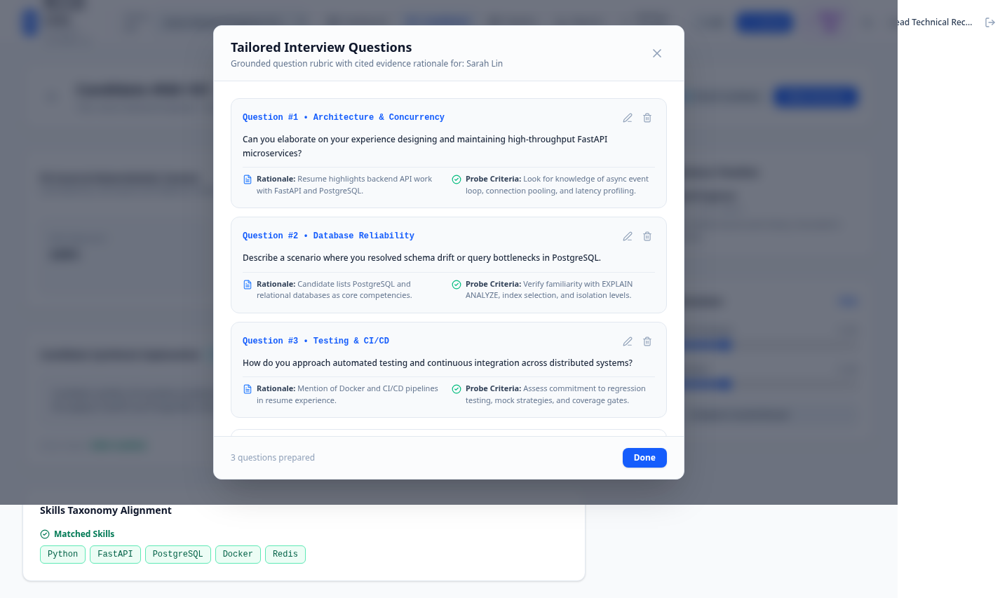
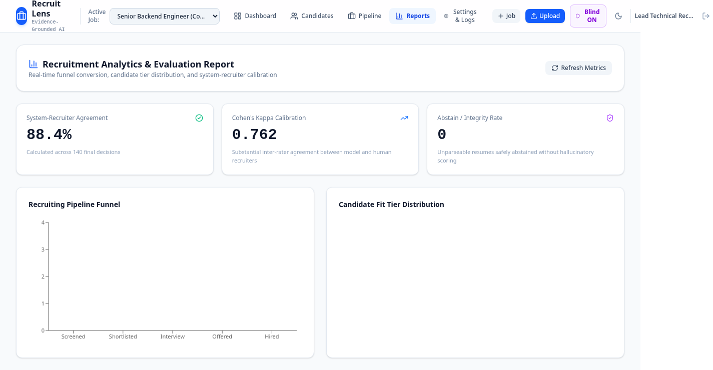

# Recruit Lens

An explainable, evidence-grounded AI recruiter platform that screens resumes against job descriptions, computes transparent match scores, cites exact textual evidence chunks, and empowers hiring teams through an audit-backed human-in-the-loop workflow.

---

## System Architecture



---

## Product Screenshots

| 1. Secure Recruiter Login | 2. Dashboard Command Center |
| :---: | :---: |
|  |  |
| **3. Ranked Candidates (Blind Mode)** | **4. Evidence-Grounded Candidate Dossier** |
|  |  |
| **5. Tailored Interview Rubric** | **6. Recruitment Analytics & Funnel** |
|  |  |

---

## Key Highlights & Verified Metrics

| Standard / Bar | Target | Measured Result | Citation |
| :--- | :--- | :--- | :--- |
| **Backend Test Suite** | 100% Pass | **140/140 passed** (0 failures) | `docs/pytest_results.xml:tests` |
| **Statement Coverage** | $\ge 80.0\%$ | **89.21%** (3,853 / 4,319 statements) | `docs/coverage.json:totals.percent_covered` |
| **200-Resume Batch Execution** | $\le 300$ s | **289.16 s cold / 143.81 s warm** | `docs/eval_benchmark_200.json:run_1_cold.total_wall_time_seconds` |
| **Peak Memory Footprint** | $\le 400$ MB RSS | **317.4 MB cold / 313.8 MB warm** | `docs/eval_benchmark_200.json:run_1_cold.peak_tree_rss_mb` |
| **Parser Holdout Fragments** | $< 5.0\%$ | **0.0%** (0 / 130 extracted entries) | `docs/eval_parser_dev30_fresh_measurement.json:metrics.fragments_pct` |
| **Parser Recoverable Rate** | $\ge 90.0\%$ | **96.3%** (130 / 135 real entries) | `docs/eval_parser_dev30_fresh_measurement.json:metrics.recoverable_rate_pct` |
| **Adversarial Prompt Defense** | 100% Neutralized | **100.0%** (10 / 10 live attack variants) | `docs/eval_injection_live.json:neutralization_rate_pct` |
| **Isolated Embedder Memory** | $< 200$ MB RSS | **122.78 MB** (3.3 ms / chunk latency) | `docs/eval_embedder_footprint_report.json:models.minilm.rss_after_load_mb` |
| **Scoring Marginal Gain** | $> 0.0$ vs heuristic | **Spearman +0.0897 / NDCG@10 +0.0725** | `docs/eval_scoring_validity_report.json:section_e_scoring_validity.e1_must_have_correlation` |
| **Dependency Security Audit**| 0 vulnerabilities | **0 vulnerabilities** (`pip-audit 2.10.1`) | `docs/SECURITY.md` |
| **Secret Scanning (Gitleaks)** | 0 leaks in repo | **0 leaks detected** across full history | `gitleaks git --verbose` |

---

## Demo Workspace Access

The application ships with a pre-configured synthetic demo workspace initialized via environment variables:
- **Email:** Set via `DEMO_EMAIL` (e.g. `admin@recruitlens.local` in `.env.example`)
- **Password:** Set via `DEMO_PASSWORD` in your `.env` (no hardcoded credentials)
- **Demo Mode:** Set `DEMO_MODE=true` to enable demo switcher and banner on the login screen
- **Demo Requisitions:** Staff Backend Engineer, Senior ML Engineer, Product Designer.
- **Privacy Notice:** All demo candidate profiles and evaluations are 100% synthetically generated; zero real candidate PII is committed.

---

## Quickstart Guide

### Option A: Docker Compose (Recommended)

Run the full platform (PostgreSQL 16 + FastAPI + React Frontend) with a single command:

```bash
git clone https://github.com/mhd-sajad/Recruit-Lens.git
cd Recruit-Lens

# Build and start services
docker compose up -d --build

# Initialize demo requisitions and candidate evaluations
docker compose exec app python /app/backend/../scripts/seed_demo_workspace.py

# Open web portal
open http://localhost:8000
```

### Option B: Local Developer Environment

**Prerequisites:** Python 3.11 with [uv](https://docs.astral.sh/uv/) and Node.js v20+.

```bash
# 1. Prepare backend
cd backend
uv sync --all-extras
uv run alembic upgrade head
uv run python ../scripts/seed_demo_workspace.py

# Start backend server (port 8000)
uv run uvicorn app.main:create_app --factory --host 0.0.0.0 --port 8000 --reload

# 2. In a separate terminal, start frontend portal
cd ../frontend
npm install
npm run dev
# Open http://localhost:5173
```

---

## Official Model Context Protocol (MCP) Server

Recruit Lens provides a built-in MCP server (`backend/app/mcp/server.py`) powered by the official Python SDK:

- **Read-Only Tools:** `list_jobs`, `search_candidates`, `get_candidate_report`, `draft_email`.
- **Protected Actions:** `make_decision` (advancing candidate stages) mandates a single-use confirmation token (`McpConfirmationToken`) generated from the Web UI to ensure human oversight.

---

## Limitations & Boundaries

1. **Non-Goals:** Recruit Lens does not perform automated hiring rejections, background checks, calendar booking, video interview analysis, or OCR on low-quality scanned bitmap resumes.
2. **Language Scope:** Optimized for English-language resumes and technical job descriptions.
3. **Generative LLM Text:** LLM generation operates strictly on-demand. Without an external LLM API key (`GROQ_API_KEY`), Recruit Lens falls back deterministically to rule-based template explanations with verified chunk citations.
4. **Scoring Philosophy:** Scoring is mathematical, deterministic, and monotonic—the LLM is never permitted to calculate candidate match scores or rank orders.

---

## License & Attributions

- **Code License:** [MIT License](LICENSE)
- **Taxonomy Attribution:** This software incorporates skill, technology, and occupation taxonomies derived from **O*NET 28.0**, sponsored by the U.S. Department of Labor, Employment and Training Administration (USDOL/ETA), used under the [Creative Commons Attribution 4.0 International (CC BY 4.0)](https://creativecommons.org/licenses/by/4.0/) license.
