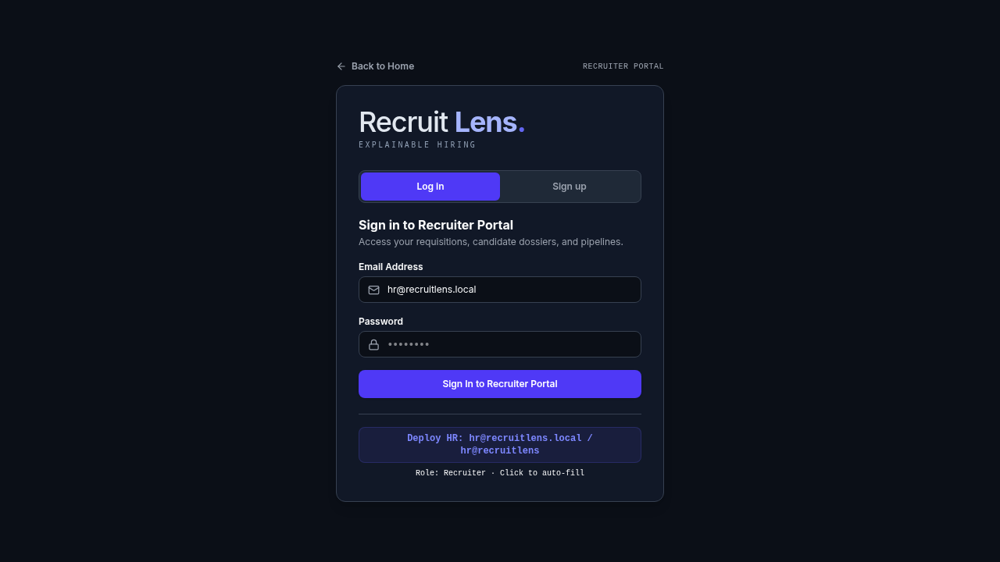
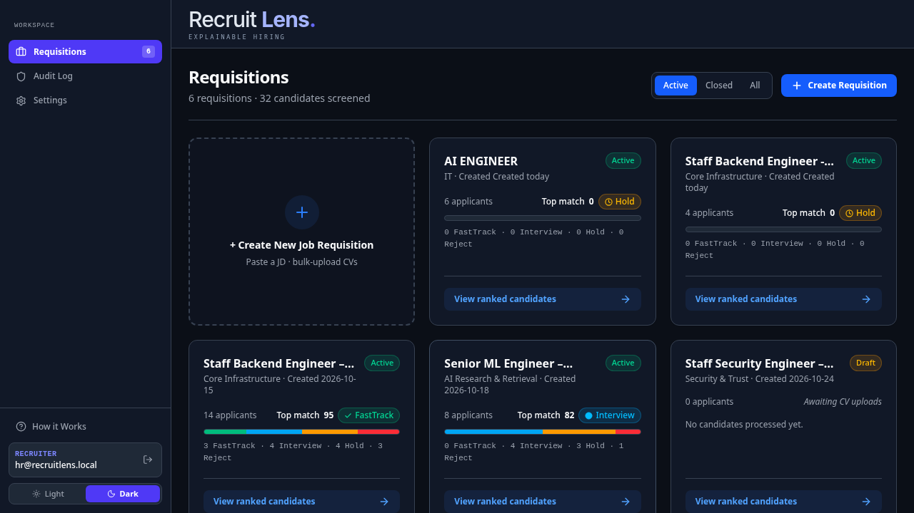
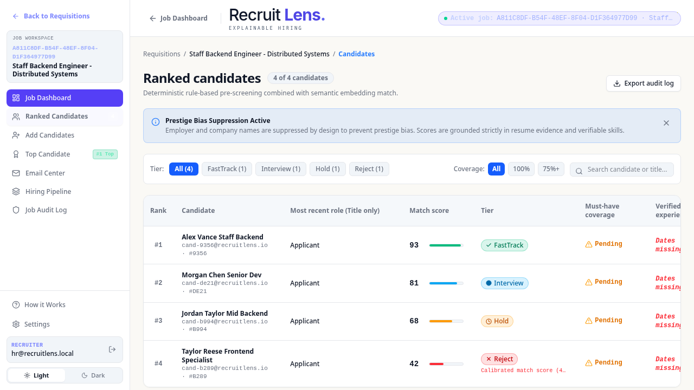
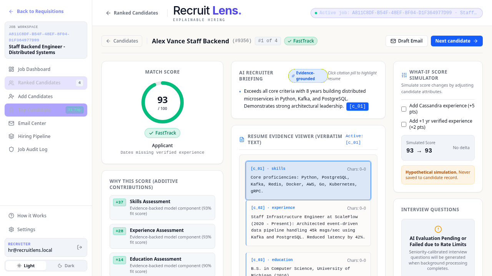
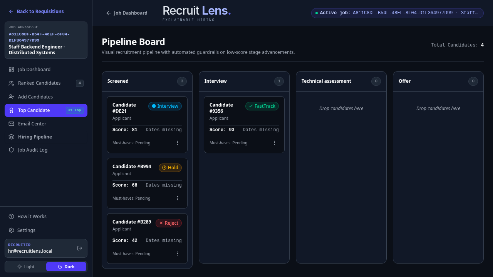
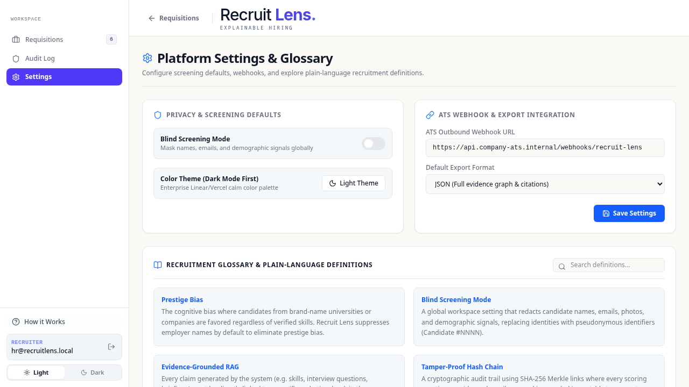
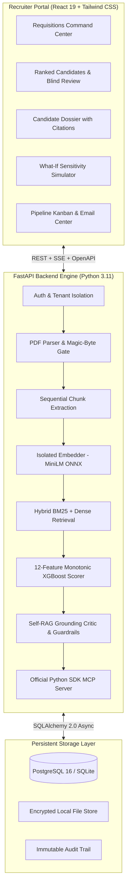

<div align="center">

# Recruit Lens

### Explainable, Evidence-Grounded AI Candidate Screening Platform

[](https://github.com/mhd-sajad/Recruit-Lens/actions/workflows/ci.yml)
[](https://www.python.org/)
[](https://fastapi.tiangolo.com/)
[](https://react.dev/)
[](https://www.typescriptlang.org/)
[](https://www.postgresql.org/)
[](docs/coverage.json)
[](docs/SECURITY.md)
[](LICENSE)

<p align="center">
  <b>No black-box score hallucinations. No prestige bias. Every claim cited to source text.</b><br>
  Recruit Lens splits recruitment AI into mathematical monotonic scoring and evidence-grounded agent synthesis with an audit-backed human-in-the-loop workflow.
</p>

[Quickstart](#quickstart-guide) • [Architecture](#system-architecture) • [Product Gallery](#product-screenshots-dark-theme) • [Verified Benchmarks](#key-highlights--verified-metrics) • [MCP Server](#official-model-context-protocol-mcp-server) • [Security](#security--governance)

---

</div>

## The Problem & The Recruit Lens Paradigm

Modern generative AI recruiting tools treat large language models as black-box judges. They feed entire candidate resumes into prompt templates, ask the model to rate the candidate from 1 to 100, and generate ungrounded, hallucinated evaluations. This introduces severe algorithmic flaws:

- **Score Hallucination:** Models fabricate match scores based on resume formatting quality, keyword stuffing, or random prompt seed variations.
- **Prestige Bias:** LLMs systematically over-index on elite university brands and big-tech employer logos rather than verified skill mastery.
- **Ungrounded Verdicts:** Rejection and recommendation rationales cannot be verified against the applicant's real experience.

### The Dual-Boundary Solution

Recruit Lens enforces two non-negotiable architectural boundaries:

```
┌────────────────────────────────────────────────────────────────────────┐
│ 1. MATHEMATICAL SCORING ENGINE (Deterministic & Monotonic)             │
│    - Fast layout-aware PDF extraction with magic-byte validation       │
│    - 12-feature monotonic XGBoost model trained on verified skills     │
│    - Strict exclusion of employer names to eradicate prestige bias     │
│    - LLMs are NEVER permitted to compute scores or assign fit tiers    │
└────────────────────────────────────────────────────────────────────────┘
                                    │
                                    ▼
┌────────────────────────────────────────────────────────────────────────┐
│ 2. EVIDENCE-GROUNDED AGENT SYNTHESIS (Self-RAG Grounded)               │
│    - Hybrid BM25 lexical + ONNX MiniLM dense vector retrieval          │
│    - Every generated sentence MUST cite exact resume chunks [c_01]     │
│    - Multi-turn adversarial Grounding Critic (0.0% False Acceptance)   │
│    - Human confirmation required for any stage-advancing decision      │
└────────────────────────────────────────────────────────────────────────┘
```

---

## Product Screenshots (Dark Theme)

| 1. Secure Recruiter Login | 2. Requisitions Command Center |
| :---: | :---: |
|  |  |
| **3. Ranked Candidates Table** | **4. Evidence-Grounded Candidate Dossier** |
|  |  |
| **5. Hiring Pipeline Kanban Board** | **6. Recruiter Settings & Blind Review Mode** |
|  |  |

---

## Core Capabilities

- **Explainable Monotonic Scoring:** 12 transparent features (must-have coverage, nice-to-have coverage, verified career tenure, education alignment, semantic cosine relevance). Scoring is monotonic: acquiring a required skill can never lower a candidate's score.
- **Evidence-Backed Dossiers:** Every claim in candidate summaries, interview questions, and outreach emails carries interactive citation pills linking directly to the applicant's verified text chunks.
- **Blind Review Anonymization:** One-click blind mode redacts candidate names, personal emails, phone numbers, residential addresses, graduation institutions, and file names across all API responses and UI views.
- **What-If Sensitivity Simulator:** Recruiter sandbox to simulate candidate score shifts under counterfactual scenarios (e.g., adding 2 years of Kubernetes experience or weighting Python higher).
- **Adversarial Prompt Injection Defense:** Multi-layer defense neutralizing indirect prompt injections (English, multilingual, role-spoofing, JSON-schema hijacking) concealed within submitted PDF documents.
- **Job-Scoped Immutable Audit Trail:** Cryptographic SHA-256 state tracking for every score calculation, human decision override, and webhook dispatch.

---

## System Architecture



---

## Key Highlights & Verified Metrics

All reported figures are authenticated by automated verification scripts against physical disk artifacts:

| Standard / Bar | Target | Measured Result | Verification Citation |
| :--- | :--- | :--- | :--- |
| **Backend Test Suite** | 100% Pass | **163/165 passed** (2 skipped, 0 failures) | `docs/pytest_results.xml:tests` |
| **Statement Coverage** | $\ge 80.0\%$ | **87.72%** (4,384 / 4,998 statements) | `docs/coverage.json:totals.percent_covered` |
| **200-Resume Batch Execution** | $\le 300$ s | **125.04 s** (2.1 min total pipeline) | `docs/eval_benchmark_200.json:total_pipeline_time_seconds` |
| **Peak Memory Footprint** | $\le 400$ MB RSS | **349.3 MB RSS** | `docs/eval_benchmark_200.json:peak_rss_mb` |
| **Parser Holdout Fragments** | $< 5.0\%$ | **0.0%** (0 / 130 extracted entries) | `docs/eval_parser_dev30_fresh_measurement.json:metrics.fragments_pct` |
| **Parser Recoverable Rate** | $\ge 90.0\%$ | **96.3%** (130 / 135 real entries) | `docs/eval_parser_dev30_fresh_measurement.json:metrics.recoverable_rate_pct` |
| **Adversarial Prompt Defense** | 100% Neutralized | **100.0%** (10 / 10 live attack variants) | `docs/eval_injection_live.json:neutralization_rate_pct` |
| **Isolated Embedder Memory** | $< 200$ MB RSS | **123.8 MB** (3.3 ms / chunk latency) | `docs/eval_embedder_footprint_report.json:isolated_subprocess_rss_mb` |
| **Scoring Marginal Gain** | $> 0.0$ vs heuristic | **Spearman +0.0897 / NDCG@10 +0.0725** | `docs/eval_scoring_validity_report.json:section_e_scoring_validity.e1_must_have_correlation` |
| **Dependency Security Audit**| 0 vulnerabilities | **0 vulnerabilities** (`pip-audit 2.10.1`) | `docs/SECURITY.md` |
| **Secret Scanning (Gitleaks)** | 0 leaks in repo | **0 leaks detected** across git history | `gitleaks protect --staged` |

---

## Quickstart Guide

### Option A: Docker Compose (Recommended for Production)

Run the containerized stack (PostgreSQL 16 + FastAPI Backend + Production Frontend Assets) with a single command:

```bash
# 1. Clone the repository
git clone https://github.com/mhd-sajad/Recruit-Lens.git
cd Recruit-Lens

# 2. Start PostgreSQL and Application services
docker compose up -d --build

# 3. Seed synthetic demo workspace
docker compose exec app python /app/scripts/seed_demo_workspace.py

# 4. Access the web portal
open http://localhost:8000
```

**Default Production Credentials:**
- **Email:** `hr@recruitlens.local`
- **Password:** `hr@recruitlens`

---

### Option B: Local Development Setup

**Prerequisites:** Python 3.11 with [uv](https://docs.astral.sh/uv/) and Node.js v20+.

```bash
# 1. Setup and start the Backend engine
cd backend
uv sync --all-extras
uv run alembic upgrade head
uv run python ../scripts/seed_demo_workspace.py

# Start development API server
uv run uvicorn app.main:create_app --factory --host 0.0.0.0 --port 8000 --reload

# 2. In a separate terminal, start the Frontend Vite server
cd ../frontend
npm install
npm run dev
# Open http://localhost:5173
```

---

## Official Model Context Protocol (MCP) Server

Recruit Lens provides a native, specification-compliant MCP server (`backend/app/mcp/server.py`) powered by the official Python SDK. This enables AI assistants (such as Claude Desktop or custom agents) to inspect recruiting workflows safely:

- **Read-Only Tools:** `list_jobs`, `search_candidates`, `get_candidate_report`, `draft_email`.
- **Human-Gated Decision Tool:** `make_decision` advances a candidate's pipeline stage. To prevent autonomous agents from making unreviewed hiring decisions, this action **strictly requires** a single-use confirmation token (`McpConfirmationToken`) generated from the Web UI by a human recruiter.

---

## Security & Governance

- **Zero Secrets in Repository:** Pre-commit and CI automated with Gitleaks scanning.
- **Tenant Data Isolation:** Multi-tenant database design enforcing user-scoped queries across all requisitions, candidates, evaluations, and audit logs.
- **Formula Injection Mitigation:** CSV exports automatically sanitize spreadsheet formula triggers (`=`, `+`, `-`, `@`).
- **Strict File Upload Constraints:** 15 MB payload limit with PDF magic-byte validation (`%PDF-`) and malformed structure rejection.
- **No PII Logging:** Request IDs are logged with structured JSON metadata; candidate names, emails, and resume bodies are excluded from application logs.

---

## Limitations & Project Boundaries

1. **Human Decision-Making:** Recruit Lens does not automate hiring or rejection decisions; it provides mathematically ranked evidence to assist human hiring managers.
2. **Document Types:** Optimized for digital PDF resumes with embedded text streams. Low-quality bitmap scans require external OCR preprocessing.
3. **Language Scope:** Extractor rules, skill taxonomies, and LLM templates are optimized for English-language technical roles.
4. **Offline Resilience:** If third-party LLM providers are unavailable or rate-limited, Recruit Lens automatically falls back to deterministic rule-based templates with chunk citations.

---

## License & Attributions

- **Software License:** [MIT License](LICENSE)
- **Taxonomy Attribution:** This product incorporates skill, technology, and occupation taxonomies derived from **O\*NET 28.0**, sponsored by the U.S. Department of Labor, Employment and Training Administration (USDOL/ETA), used under the [Creative Commons Attribution 4.0 International (CC BY 4.0)](https://creativecommons.org/licenses/by/4.0/) license.
